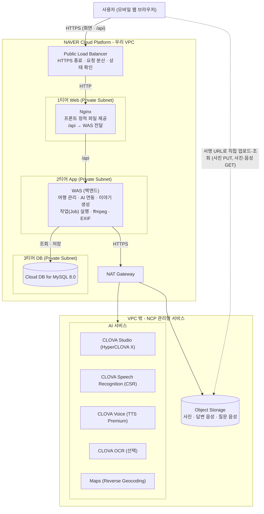

# 여행말 아키텍처 구상도

| 항목 | 내용 |
| --- | --- |
| 문서명 | 아키텍처 구상도 (통합본) |
| 버전 | v0.2 — 팀 구상도(3티어 + Load Balancer + NAT Gateway)를 기준으로 03·04·05 문서와 정합 |
| 원본 | 팀 구상도 이미지(프로젝트_클라우드_구상도.png) — 구조는 그대로 두고 아래 보완 사항만 덧붙였다 |
| 함께 보는 문서 | 02 ERD · 03 데이터 테이블 설계서 · 04 API 기능명세서 · 05 프론트엔드 기능명세서 |

## 1. 구성도

> Maps 박스와 "CSR" 표기는 원본 구상도에 없던 것을 보완한 부분이다(3장 1·2번).

## 2. 구성 요소

| 구성 | 역할 | NCP 서비스 / 비고 |
| --- | --- | --- |
| Public Load Balancer | HTTPS 종료(인증서), 요청 분산, 상태 확인. 마이크는 HTTPS에서만 동작하므로 필수 | Load Balancer |
| Web 티어 | 프론트 정적 파일(React 빌드) 제공 + `/api`를 WAS로 전달. 프론트와 API가 같은 출처가 된다 | Server (Nginx), Private Subnet |
| App 티어 (WAS) | REST API, 작업(Job) 실행, 외부 AI 호출, ffmpeg·EXIF 처리. 언어는 자유(예시는 Python/FastAPI) | Server, Private Subnet |
| DB 티어 | 사용자·여행·장면·질문·발화·챕터·작업(03 설계서 14개 테이블, utf8mb4) | Cloud DB for MySQL, Private Subnet |
| 외부 호출 경로 | WAS가 VPC 밖 NCP 관리형 서비스(AI·Object Storage)에 나가는 길 | NAT Gateway |
| 파일 저장 | 사진 원본, 사용자 답변 음성, 질문 음성(mp3). 비공개 버킷 | Object Storage (S3 호환) |
| 장소명 | 사진 GPS 좌표 → 주소 | Maps: Reverse Geocoding |
| 음성 → 텍스트 | 답변 전사(1회 60초) | CLOVA Speech Recognition (CSR) |
| 텍스트 → 음성 | 질문 음성 mp3 | CLOVA Voice (TTS Premium) |
| 생성형 AI | 장면 설명(이미지 1장/호출), 질문·챕터·제목·문체 | CLOVA Studio (HCX-005 / HCX-DASH-002) |
| 글자 읽기(선택) | 간판·메뉴 OCR | CLOVA OCR (General) |
| 썸네일 | 장면 카드·표지용 축소 이미지 | Cloud Image Optimizer, 또는 WAS에서 Pillow(MVP) |

## 3. 구상도에서 보완한 점

| # | 내용 | 이유 · 조치 |
| --- | --- | --- |
| 1 | AI 서비스 박스에 **Maps(Reverse Geocoding)** 추가 | 03 설계서 7-1의 "GPS 좌표를 장소명으로 변환"에 필요 |
| 2 | "Speech"를 **CLOVA Speech Recognition(CSR)** 으로 명시 | CLOVA Speech(긴 음성)와 CSR(1회 60초)은 다른 서비스. 프론트의 55초 제한은 CSR 기준 |
| 3 | Nginx가 **`/api` 접두**로 API를 전달 | 화면 경로(/books/:id, /trips/new 등)와 API 경로가 같아서 접두 없이는 구분이 안 된다. Nginx가 `/api/`를 WAS로 보내며 접두를 제거(WAS는 /users, /trips …로 받음) |
| 4 | Object Storage 버킷 **CORS**에 브라우저 PUT/GET 허용 | "서명 URL로 직접 업로드·조회" 화살표가 동작하려면 필요. 서명 URL(사전 서명) 지원 여부는 NCP 공식 문서로 확인하지 못했으므로 구현 초기에 시험하고, 안 되면 WAS가 받아서 저장(04 E05 대안 A, 프론트 수정 없음) |
| 5 | 로드밸런서 → Nginx는 **HTTP**, 브라우저 → 로드밸런서는 **HTTPS** | 쿠키 Secure 속성·리다이렉트가 맞도록 WAS가 `X-Forwarded-Proto`를 신뢰하게 설정 |
| 6 | 서브넷 구성(LB 전용·NAT 전용 서브넷 등) | NCP VPC의 서브넷 종류·라우팅 요건은 구현 전에 공식 문서로 확인(확인 필요) |
| 7 | **타임아웃 60초 이상** (LB·Nginx·WAS 모두) | 답변 처리(04 E11)가 전사·질문 생성·음성 합성까지 동기로 최대 20초 안팎 |
| 8 | **요청 크기 제한** 상향 | 답변 녹음 업로드(수 MB)가 Nginx 기본 제한(1MB)에 걸리지 않도록 `client_max_body_size` 상향 |
| 9 | **단일 인스턴스** 표기 | 티어별 1대면 단일 장애점이다. DB·작업 상태가 이미 서버 밖(MySQL, tb_job)에 있으므로 나중에 WAS를 복제해 Load Balancer 뒤에 붙이면 확장된다(작업 실행을 tb_job 행 잠금 방식으로 바꿔야 함 — 04 6.6) |
| 10 | 비밀 키는 **WAS 환경 변수**에만 | NCP 호출 키는 프론트·저장소에 두지 않는다(04 8장) |

## 4. 요청 흐름

### 4.1 화면과 API

1. 브라우저가 `https://서비스 도메인/`을 연다 → Load Balancer → Nginx가 React 정적 파일을 돌려준다.
2. 화면이 `/api/...`를 호출한다(같은 출처, 쿠키 자동 전송) → Load Balancer → Nginx(`/api` 접두 제거) → WAS → MySQL.
3. 화면 진입 가드: `GET /api/users/me` — 쿠키가 없거나 사용자가 없으면 401, 화면이 /start로 보낸다.

### 4.2 사진 업로드

1. 화면이 `POST /api/trips/:id/days/:day/photos/upload-urls`로 업로드 주소를 받는다(WAS가 사전 서명 URL 발급, 사진 행은 UPLOADING).
2. 브라우저가 Object Storage로 사진을 **직접 PUT** 한다(WAS를 거치지 않음, CORS 필요).
3. 화면이 `POST …/analyze`를 호출하면 WAS가 객체 존재를 확인해 READY로 바꾸고 분석 작업을 시작한다.

### 4.3 인터뷰 (동기 처리)

1. `POST …/interview/start` → WAS가 CLOVA Studio로 첫 질문 생성 → CLOVA Voice로 mp3 합성 → Object Storage 저장 → 서명 URL 반환.
2. 사용자가 답하면 `POST …/interview/answer`(multipart, 최대 55초) → WAS가 ffmpeg로 wav 변환 → CSR 전사 → 다음 질문 생성 → TTS → 응답. 한 번에 최대 약 20초.
3. 건너뜀·빈 전사는 SKIPPED로 처리하고 `skipped=true`로 응답한다.

### 4.4 비동기 작업 (분석 · 챕터 · 책 · 문체)

1. 시작 API가 즉시 `{ jobId }`를 돌려준다(WAS가 tb_job 행을 만들고 백그라운드로 실행).
2. 화면이 `GET /api/jobs/:jobId`를 2초마다 확인한다. 상태·진행률은 tb_job에서 읽는다.
3. 서버가 재시작되면 RUNNING 작업은 FAILED로 바꾸고 화면의 재시도로 새 작업을 만든다.

### 4.5 사진·음성 열람

사진·음성은 비공개 버킷에 있고, 응답에 담기는 URL은 요청 때마다 만든 서명 URL(GET 1시간)이다. 브라우저가 이 URL로 Object Storage에서 직접 받는다.

## 5. 보안

| 항목 | 규칙 |
| --- | --- |
| 인증 | 서버 발급 무작위 토큰을 HttpOnly·Secure·SameSite=Lax 쿠키로 전달, DB에는 SHA-256 해시만 저장 (03 설계서 6장) |
| 접근 제어 | 모든 요청에서 쿠키 사용자가 소유자인지 검사, 남의 데이터는 404 |
| 비밀 키 | NCP API 키·Studio 키·DB 비밀번호는 WAS 환경 변수 또는 비밀 저장소. 깃·프론트에 두지 않는다 |
| 파일 | 버킷 비공개, 서명 URL만 사용(업로드 15분, 열람 1시간). 사용자별 경로 `users/{userId}/…` |
| 네트워크 | Web·App·DB는 Private Subnet. 외부에서 직접 접근 가능한 것은 Load Balancer뿐. DB는 WAS 서버에서만 접속 허용(ACG) |
| 삭제 | 사용자가 삭제하면 Object Storage 객체를 먼저 지우고 DB 행을 지운다(03 설계서 11장) |
| 개인정보 | 사진(GPS 포함)·음성은 민감 정보. 원본 음성 보관은 설정으로 끌 수 있다 |

## 6. 환경 구성 (요약)

| 환경 | 구성 |
| --- | --- |
| 로컬 개발 | 프론트 `npm run dev`(Vite, 포트 5173), 백엔드 `localhost:8080`. Vite 프록시가 `/api`를 백엔드로 전달. 프론트는 mock(`VITE_USE_MOCK=true`)만으로도 전체 흐름이 돈다 |
| 시연·운영 | 위 구성도(HTTPS 필수). 프론트 `VITE_USE_MOCK=false`, `VITE_API_BASE_URL=/api` |

## 7. 구축 순서

1. VPC·서브넷·서버(Web·App)·Cloud DB for MySQL·NAT Gateway·Load Balancer 생성, ACG 설정.
2. Cloud DB에 03 설계서 12장 DDL 실행, 공통 코드 시드 입력.
3. Nginx 설정(정적 파일, `/api` 전달, 타임아웃·본문 크기), Load Balancer HTTPS 인증서.
4. Object Storage 버킷 생성 + CORS, 서명 URL 시험.
5. WAS 배포 후 `/api/users/me`가 401을 돌려주는지 확인 → 이후 04 문서 9장 순서로 기능을 붙인다.

## 8. 제한 · 위험

| 항목 | 내용 | 대응 |
| --- | --- | --- |
| 서명 URL | NCP Object Storage에서의 사전 서명 URL 지원을 문서로 확인하지 못함 | 구현 초기에 시험, 안 되면 WAS 경유 업로드 |
| 단일 장애점 | 티어별 1대 | MVP 허용, 확장 경로는 3장 9번 |
| 서브넷·NAT | 서브넷 종류·라우팅 요건 | 구현 전 공식 문서 확인 |
| 호출 한도·비용 | CSR 사용량 한도, HyperCLOVA X 토큰 과금 | 시연 데이터로 호출 수 산정, 질문 음성·전사는 캐시 |
| iPhone 사진 위치정보 | iPhone Safari에서 사진을 고를 때 GPS가 빠질 수 있음(확인 필요) | GPS가 없어도 동작(장소명 비움), 시연용 사진은 위치정보 포함 확인 |
| HTTPS | 마이크는 HTTPS 또는 localhost에서만 동작 | Load Balancer에서 HTTPS 종료, 폰 시연은 HTTPS 배포 필요 |
