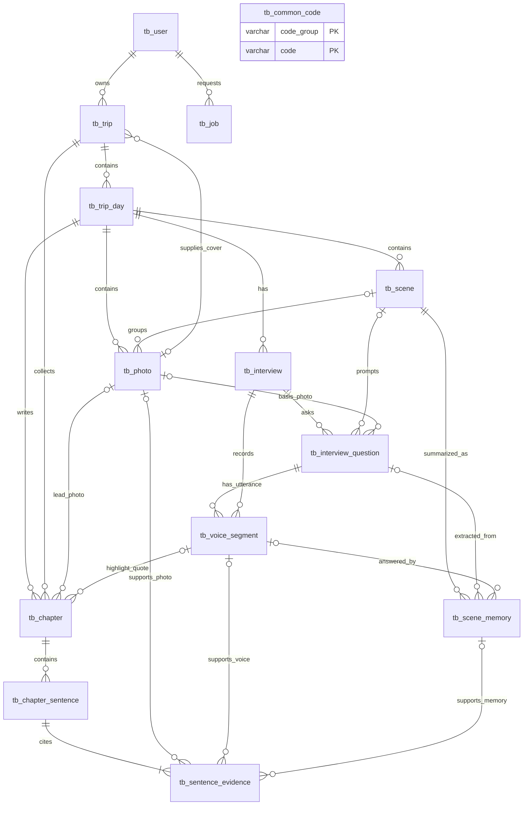

# 여행말 서비스 ERD

| 항목 | 내용 |
| --- | --- |
| 문서명 | ERD (통합본) |
| 버전 | v0.5 — 03 데이터 테이블 설계서 v0.5와 같은 구조 |
| 개발 마감 | 2026년 10월 16일 |
| 데이터베이스 | Cloud DB for MySQL 8.0 |
| 파일 저장 | NCP Object Storage |
| 테이블 수 | 14개 (`tb_` 접두, 03 설계서 표기) |
| 책·챕터 표현 | `tb_trip` = 여행(책), `tb_trip_day` = 날짜별 챕터 기록, `tb_chapter` = 일차별 글(버전 관리) |
| 이용자 식별 | 브라우저 쿠키 기반 익명 접근 |

> 이 그림은 03 데이터 테이블 설계서(v0.5)의 시각화 버전이다. 컬럼·타입·제약·DDL은 03 문서가 기준이며, 이 문서는 관계와 정책 요약만 담는다. 이전 ERD(10개 테이블)와 달라진 점은 4장에 정리했다.

## 1. 적용 정책

- 닉네임은 표시 이름이며, 서버가 발급한 쿠키로 익명 이용자를 식별한다. 쿠키를 잃으면 기존 책장에 접근할 수 없다.
- 사진·장면·이전 답변을 바탕으로 다음 질문을 **동적으로** 생성한다(질문 5개, 답변이 확정될 때마다 1개씩).
- 인터뷰 재개 시 순서상 첫 미답변(`ASKED`) 질문부터 진행한다. 건너뜀·빈 답변은 답한 질문으로 세지 않는다.
- 완료된 답변은 수정하지 않는다.
- 인터뷰 원본 음성은 답변(발화) 단위로 보관한다(설정으로 끌 수 있음). 답변 전사와 해당 음성 발화를 연결한다.
- 생성된 이야기의 **각 문장**에 근거 사진·발화를 연결한다.
- 생성 실패 시 재시도한다. 문체를 바꾸면 챕터에 새 버전이 생기고, 모든 일차가 완성된 뒤 한 번에 교체한다.
- 복구 코드·다중 기기 지원은 제외한다. PDF 내보내기는 MVP 제외(프론트는 시연용 안내만), NOVEL 문체는 제외한다.

## 2. ERD

`tb_common_code`는 다른 테이블과 FK로 연결하지 않고 코드값을 문자열로 참조한다(03 설계서 5장).

## 3. 테이블 요약

| 테이블 | 핵심 컬럼 | 설명 |
| --- | --- | --- |
| tb_user | browser_token_hash, nickname(20), interviewer_voice, keep_audio_yn | 익명 책장 소유자·설정 |
| tb_trip | user_id, destination, start/end_date, companion_type, title, status, cover_photo_id, cover_color_set, writing_style | 여행 = 책 |
| tb_trip_day | trip_id, day_no, travel_date, status | 일차 = 챕터 기록 단위 (UNIQUE trip+day_no) |
| tb_photo | trip_day_id, scene_id, storage_key, upload_status, taken_at, 좌표, place_name, ocr_text, caption, analysis_status | 사진·분석 결과 |
| tb_scene | trip_day_id, seq, scene_type(PHOTO/GAP), start/end_time, title, summary, place_name, gap_min | 장면·사진 없는 시간 후보 |
| tb_interview | trip_day_id, status, end_type, answered_cnt | 일차별 인터뷰 세션 |
| tb_interview_question | interview_id, seq, scene_id, photo_id, question_text, question_type, status | 질문(동적 생성)과 상태 |
| tb_voice_segment | interview_id, question_id, speaker, audio_key, transcript, start_sec, duration_sec, status | AI 질문 음성 / 사용자 답변 음성·전사 |
| tb_scene_memory | scene_id, question_id, voice_segment_id, action/feeling/place/photo_text | 장면별 글감(챕터 작성 1단계에서 생성) |
| tb_chapter | trip_id, trip_day_id, chapter_no, title, subtitle, moments, photo_id, highlight_*, style_code, version, current_yn, status | 일차별 글(버전) |
| tb_chapter_sentence | chapter_id, paragraph_no, seq, content | 이야기 문장 |
| tb_sentence_evidence | sentence_id, evidence_type, photo_id / voice_segment_id / scene_memory_id | 문장별 근거 |
| tb_job | user_id, job_type, target, status, progress, active_key | 비동기 작업(분석·작성·엮기·문체) |
| tb_common_code | code_group, code | 코드 |

## 4. 이전 ERD(10개 테이블)와의 대응

| 이전 ERD | 통합본 | 비고 |
| --- | --- | --- |
| VISITOR | tb_user | 닉네임 50 → 20자, token_hash BINARY(32) → CHAR(64), voice_code → interviewer_voice, keep_audio_yn 추가 |
| TRIP | tb_trip | `binding_*` 컬럼 4개 → tb_job + `status`(BINDING/FAILED). `book_title` → `title`, `cover_photo_id` 유지, `day_count` 없음 |
| TRIP_DAY | tb_trip_day + tb_chapter | `chapter_title`·`subtitle`·`moments`·`highlight_*`은 tb_chapter로. `analysis_*`·`story_*`·`interview_status`는 day `status` + tb_job + tb_interview로 |
| PHOTO | tb_photo | `object_key` → `storage_key`, `analysis_json` → `ocr_text`·`caption`·`place_name` 컬럼, `utc_offset_minutes` 삭제(현지 시각만 저장) |
| SCENE | tb_scene | `PHOTO_GROUP`/`TIME_GAP` → `PHOTO`/`GAP`, `label` → `title`, `location_name` → `place_name`, `note` → `summary` |
| INTERVIEW_RECORDING | tb_voice_segment | 통화 전체 녹음 1개 + 구간 방식 → 답변 단위 발화. 프론트가 답변마다 녹음 파일을 올리기 때문 |
| QUESTION | tb_interview + tb_interview_question | 답변 텍스트·음성 구간은 tb_voice_segment로 |
| STORY_SENTENCE | tb_chapter_sentence | 거의 동일 |
| SENTENCE_PHOTO + SENTENCE_ANSWER | tb_sentence_evidence | 유형(PHOTO/VOICE/MEMORY)과 CHECK 제약으로 통합 |
| (없음) | tb_job, tb_scene_memory, tb_common_code | jobId 폴링과 장면별 글감, 코드 관리에 필요 |

## 5. 관계와 카디널리티

| 관계 | 카디널리티·규칙 |
| --- | --- |
| 이용자 → 여행 | 1 : 0..N (진행 중은 1개, WRITING·BINDING·FAILED) |
| 여행 → 일차 | 1 : N (여행 생성 때 기간만큼 모두 생성) |
| 일차 → 사진·장면·인터뷰·챕터 | 각각 1 : 0..N |
| 장면 → 사진 | 장면에 사진 0..N, 사진은 장면 0..1 |
| 장면 → 질문 | 장면에 질문 0..N, 질문은 장면 0..1 (CLOSING 질문은 없음) |
| 인터뷰 → 질문 | 1 : 0..5 (답변이 확정될 때마다 하나씩 생성) |
| 질문 → 발화 | 1 : 1..2 (AI 1 + USER 0..1, 건너뜀이면 USER 없음) |
| 문장 ↔ 근거 | 1 : 1..N, 근거 유형별로 사진·발화·장면 기억을 가리킴 |
| 일차 → 챕터 | 1 : N 버전, 현재 버전(`current_yn=Y`)은 일차당 1개(DB가 보장) |
| 여행 표지 사진 | 최대 1개, 같은 여행의 사진 |
| 챕터 대표 인용 발화·본문 사진 | 최대 1개씩, 같은 일차의 발화·사진 |

## 6. 상태값

| 컬럼 | 상태 |
| --- | --- |
| tb_trip.status | WRITING, BINDING, DONE, FAILED, DELETING |
| tb_trip_day.status | READY, ANALYZING, SCENE_READY, INTERVIEWING, WRITING, DONE, FAILED |
| tb_photo.upload_status | UPLOADING, READY, FAILED, DELETE_PENDING |
| tb_photo.analysis_status / tb_scene_memory.extract_status | PENDING, DONE, FAILED |
| tb_interview.status / end_type | IN_PROGRESS, ENDED / DONE, SAVE_EXIT, DISCARD |
| tb_interview_question.status | ASKED, ANSWERED, SKIPPED |
| tb_voice_segment.status | READY, DELETE_PENDING |
| tb_chapter.status | WRITING, DONE, FAILED |
| tb_job.status | QUEUED, RUNNING, DONE, FAILED (API에서는 running / done / failed) |

- 중단된 인터뷰는 `IN_PROGRESS`로 남고, 다음 접속에서 현재 `ASKED` 질문부터 이어 한다.
- 조기 완료(SAVE_EXIT)는 현재 `ASKED` 질문을 `SKIPPED`로 바꾸고 인터뷰를 `ENDED`로 바꾼다. 아직 생성하지 않은 질문은 만들지 않는다.
- 진행률은 `progress_done / progress_total`(0~1)이며 사진 수와 구분한다.
- 상태 전이 전체는 03 설계서 9-3장.

## 7. 무결성 · 저장 규칙 (요약)

- 모든 조회·변경에서 쿠키 이용자가 여행 소유자인지 검사한다.
- 사진·장면·질문·발화·문장·근거는 같은 일차에 속해야 한다. 표지 사진은 같은 여행에 속해야 한다.
- `ANSWERED` 질문은 비어 있지 않은 전사를 가진 USER 발화를 가진다. 빈 전사는 `SKIPPED`.
- 공개하는 모든 문장에는 사진 또는 확정 답변 근거가 1개 이상 있어야 하며, 문장과 근거는 한 트랜잭션으로 저장한 뒤 챕터를 DONE으로 바꾼다.
- 같은 대상의 진행 중 작업은 `tb_job.active_key` 유니크 제약으로 1개만 허용한다.
- 인터뷰 시작 후 사진 추가·장면 재구성은 제한한다(API 409 `INTERVIEW_STARTED`).
- 서버 재시작으로 중단된 RUNNING 작업은 FAILED(`SERVER_RESTART`)로 바꿔 재시도할 수 있게 한다.

### 데이터 삭제 (순서가 중요)

1. 여행을 `DELETING`으로 바꿔 업로드·생성·결과 반영을 차단한다.
2. 사진·발화를 `DELETE_PENDING`으로 표시하고 Object Storage 객체를 삭제한다. 실패하면 객체 키와 DB 행을 남겨 재시도한다.
3. 객체 삭제 확인 후 순환 참조(표지 사진, 챕터 본문 사진, 챕터 대표 인용 발화)를 NULL로 푼다.
4. 근거 → 문장 → 챕터 → 장면 기억 → 발화 → 질문 → 인터뷰 → 사진 → 장면 → 일차 → 여행 → 작업 → 사용자 순으로 지운다.
5. 마지막에 쿠키를 만료시킨다.

### 순환 참조 (DDL 작성·삭제 순서)

- `tb_trip.cover_photo_id` ↔ `tb_photo`: tb_trip 생성 후 tb_photo를 만들고 FK를 ALTER로 추가한다.
- 챕터의 본문 사진·대표 인용 발화는 사진·발화 테이블 뒤에 만들므로 순환이 아니다.

## 8. 조회 시 계산하는 데이터

여행 일차·일수, 책등 두께, 사진 수, 챕터 수, 책 목소리 분, 책 본문 조합, 사진·음성 접근 URL은 저장하지 않고 계산한다(03 설계서 8장). 별도 `BOOK`·`ANSWER` 테이블은 두지 않는다.
